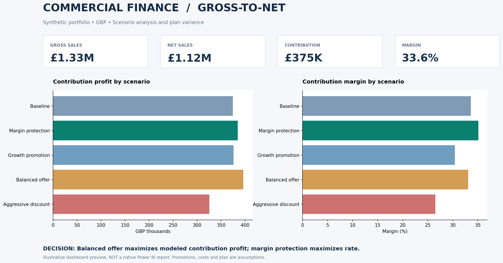

# Gross-to-Net Sales & Promotion Variance Model

**Independent commercial finance project** · Excel financial modeling · Power Query-compatible data · Power BI build kit

> **Data disclosure:** This version uses **9,000 synthetic retail transactions** and documented assumptions for discounts, trade spend, returns, COGS, variable selling expenses and budgets. Results are **GBP-denominated modeled scenarios**, not actual sales, verified promotional returns, or savings achieved for an employer. The dashboard above is a **static preview**; a native Power BI `.pbix` has **not** been created.

## Business challenge

Sales growth does not automatically mean better profit. This model examines how promotional discounting and volume assumptions change **gross sales, net sales, contribution profit, and margin**, then compares results against a modeled financial plan.

**Main question:** Which promotion should a commercial finance team recommend when the option with the best margin rate does not produce the most profit?

## Key modeled results

| Metric | Baseline modeled result |
|---|---:|
| Transactions | 9,000 |
| Gross sales | £1,326,363 |
| Net sales | £1,115,343 |
| Contribution profit | £374,674 |
| Contribution margin | 33.59% |
| Contribution variance against modeled plan | **−£67,539** |

### Promotion scenarios

| Scenario | Contribution profit | Margin | Profit change vs baseline |
|---|---:|---:|---:|
| Baseline | £374,674 | 33.59% | — |
| Margin protection | £384,599 | **35.11%** | +£9,925 |
| Growth promotion | £375,963 | 30.40% | +£1,290 |
| Balanced offer | **£396,053** | 33.08% | **+£21,379** |
| Aggressive discount | £325,461 | 26.53% | −£49,213 |

**Decision insight:** Under the documented assumptions, *balanced offer* maximizes absolute contribution profit (+£21.4K), while *margin protection* raises the contribution margin rate by **1.51 percentage points**. The aggressive discount produces more modeled gross sales but **£49.2K less** contribution profit than baseline. These are scenario comparisons, not experimentally measured causal effects.

## Budget variance analysis

The modeled actual contribution profit is **£67,539 below plan**. The plan-to-actual bridge isolates these contributions to that change:

| Driver | Effect on contribution vs plan |
|---|---:|
| Gross sales volume / price | −£53,055 |
| Promotional discounts | −£34,349 |
| Returns and allowances | −£1,698 |
| Trade spend | −£1,167 |
| Cost of goods sold | +£26,974 |
| Variable selling costs | −£4,244 |

**Interpretation:** Lower modeled gross sales and higher promotion discounts are the largest negative drivers. More favorable COGS partly offsets those shortfalls. The bridge reconciles to the total contribution-profit variance (subject to rounding).

## Model design and calculations

1. **Gross sales** = sum of transaction quantity × unit price.
2. **Net sales** = gross sales − promotional discounts − returns/allowances − trade spend.
3. **Contribution profit** = net sales − modeled COGS − modeled variable selling costs.
4. **Contribution margin** = contribution profit ÷ net sales.
5. **Plan-to-actual variance** = modeled actual contribution − modeled planned contribution.
6. **Scenario sensitivity** = recalculate promotion rate, spend, volume assumptions and relevant costs for each strategy.

The workbook contains model assumptions, monthly financial results, variance bridge, scenario comparison and Excel dashboard. The CSV outputs support Power BI Desktop import. Rate, cost and plan assumptions are **illustrative** and must not be interpreted as observed transaction-level measures.

## Repository contents

| File | Purpose |
|---|---|
| `Gross_to_Net_Upgraded_Model.xlsx` | Excel model, scenarios, assumptions, variance calculations and dashboard |
| `retail_transactions_SYNTHETIC.csv` | 9,000 explicitly synthetic transaction rows |
| `powerbi_monthly_financials.csv` | Monthly/category financial table for visuals |
| `powerbi_scenario_financials.csv` | Scenario financial summary |
| `variance_bridge.csv` | Plan-to-actual variance components |
| `POWER_BI_MEASURES.dax` | DAX expressions for Power BI |
| `POWER_BI_BUILD_GUIDE.md` | Step-by-step instructions for finishing an interactive `.pbix` |
| `dashboard_preview.png` | Static dashboard image, **not** a Power BI screenshot |
| `verified_results.json` | Rounded modeled figures for cross-checking |

## How to explore the project

1. Open `Gross_to_Net_Upgraded_Model.xlsx` in Excel and review the Dashboard, Assumptions, scenarios and variance bridge.
2. Inspect how the assumed discount and volume changes affect **profit dollars and contribution margin**; do not treat the scenario with the highest margin percentage as necessarily best.
3. To reproduce in Power BI Desktop, follow [`POWER_BI_BUILD_GUIDE.md`](POWER_BI_BUILD_GUIDE.md) and import the CSVs. A native `.pbix` is **not included**.

## Dataset provenance and next extension

The project currently uses **synthetic data**, not a real retailer's sales history. A possible future extension is the [UCI Online Retail dataset](https://archive.ics.uci.edu/dataset/352/online+retail) (Chen, D., 2015; [DOI](https://doi.org/10.24432/C5BW33)). This real dataset provides quantity, unit price, date and cancellation information, but **does not contain actual trade spending, promotion rates, cost of goods sold, or approved budgets**. Any such modeled fields must still be presented as assumptions.

## Scope and limitations

This is an independent demonstration of commercial-finance analysis, **not a company project, official P&L, SAP/TPM implementation, or measurement of incremental promotional ROI**. It does not establish that real consumers would respond to a promotion as the volume scenario assumes. An actual investment recommendation would require validated customer agreements, promotion mechanics, cost inputs and volume elasticity estimates.
